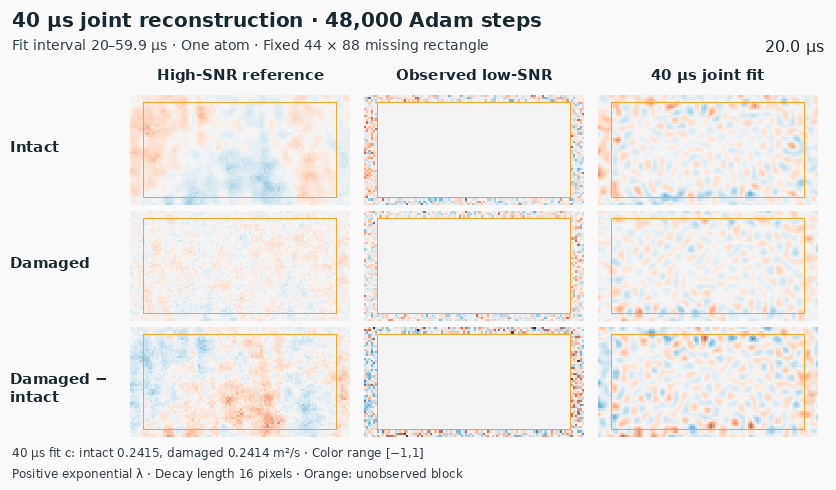
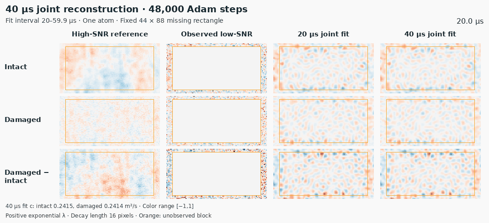
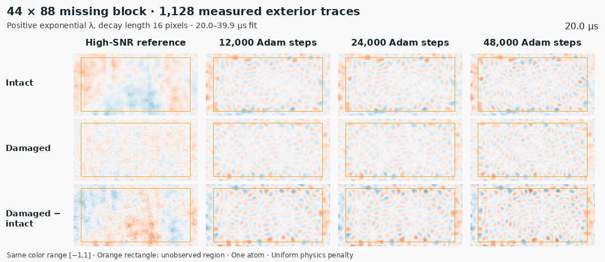
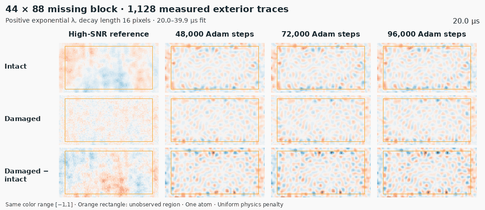

# WITC for Kirchhoff–Love plate waves

Major completed experiments reconstructing intact and damaged laser-ultrasound wavefields across a centered missing rectangle. Includes improvements and negative results. These are factorization experiments using the KL-PINN dataset, not a claim to reproduce that paper's numerical results.

## Findings

- **48,000 epochs is a useful baseline.** On 20–39.9 µs, missing-region relative L2 error improved from 0.9526 to 0.7832 (intact) and 0.9581 to 0.7836 (damaged) between 12k and 48k epochs.
- **96,000 epochs gives diminishing returns.** Errors became 0.7788 and 0.7861: a small intact improvement and a small damaged deterioration.
- **Independent temporal chunks did not help the tested configurations.** Both 5 and 10 µs windows were inferior to the joint 20 µs fit. This does not rule out overlapping or coupled windows.
- **Joint fitting over 20–59.9 µs retains most earlier accuracy.** Common-interval errors are 0.7910/0.7884 versus 0.7832/0.7836 for the shorter fit. Later frames remain harder; recovered amplitudes remain attenuated.

## GIF gallery

Rows show intact, damaged, and damaged-minus-intact fields. No additional registration/calibration is applied to difference fields. Fixed color scale [-1,1]; metrics use unclipped arrays. Previews retain every sixth original frame and use 64 colors, without spatial resizing; durations are preserved. Original-resolution frames and full-frame-rate animations remain in the source checkpoint archives.

### Joint 40 µs reconstruction: 20–59.9 µs

### Joint 20 versus joint 40 µs: common interval

### 12k, 24k, and 48k epochs

### 48k through 96k epochs

### Independent chunks

- [3.4 µs chunks, starting at 23 µs](WITC_3p4us_chunks_48000.gif)
- [5 µs chunks, starting at 20 µs](WITC_5us_windows_48000.gif)
- [10 µs chunks, starting at 20 µs](WITC_10us_windows_48000.gif)

## Missing-region error

Relative L2 error; smaller is better. Epoch budgets are per fit, not equal total computational budgets.

| Fit | Evaluation interval (µs) | Intact | Damaged |
|---|---|---:|---:|
| Joint 20 µs, 12k | 20–39.9 | 0.952578 | 0.958093 |
| Joint 20 µs, 24k | 20–39.9 | 0.944830 | 0.943997 |
| Joint 20 µs, 48k | 20–39.9 | 0.783228 | 0.783604 |
| Joint 20 µs, 96k | 20–39.9 | 0.778793 | 0.786124 |
| Four 5 µs chunks, 48k each | 20–39.9 | 0.848441 | 0.858563 |
| Two 10 µs chunks, 48k each | 20–39.9 | 0.931496 | 0.833145 |
| Joint 40 µs, 48k | 20–39.9 | 0.791021 | 0.788401 |
| Joint 40 µs, 48k | 40–59.9 | 0.823207 | 0.865827 |
| Joint 40 µs, 48k | 20–59.9 | 0.803075 | 0.813762 |

The 3.4 µs trials cover 23–39.9 µs and yield 0.935223/0.943328. Their historical comparator was trained on 20–39.9 µs and cropped for evaluation (0.776441/0.775102); this is not a matched-start ablation.

Detailed saved tables: [48k](epochs48_metrics.csv), [96k](epochs96_metrics.csv), [5/10 µs](chunk5_10_metrics.csv), [3.4 µs](chunk34_metrics.csv), [joint 40 µs](joint40_metrics.csv).

## Model and selected configuration

After division by flexural rigidity:

$$u_{xxxx}+2u_{xxyy}+u_{yyyy}+c^{-2}u_{tt}=0,\qquad k=1/c,\qquad k^2=\rho h/D.$$

**c has units m²/s, not m/s.** The spatial operator uses composed second-order Laplacians, `(Lx + Ly)^2 = Lx^2 + 2 Lx Ly + Ly^2`, rather than a direct fourth-derivative stencil. Cosine diagonalization imposes an even-extension endpoint closure.

The one-atom model uses a full space-time atom and a scalar coefficient, not a rank-one space/time separation. Adam optimizes the atom/coefficient, with bounded exact conditional updates of `1/c²`. No weighted global-optimality claim is made.

| Parameter | Value |
|---|---|
| Grid / spacing | 50 × 100; dx=dy=0.2 mm |
| Time sampling | 0.1 µs |
| Missing block | rows [3:47], columns [6:94]; 44 × 88 |
| Observations | All 1,128 exterior traces, every time sample |
| Atoms | One per fit; gradient descent active |
| Amplitude penalty | λ(x,y)=0.01 exp(-distance/16 pixels), strictly positive |
| Physics coefficient γ | 1e-4 |
| Adam learning rate | 1e-4 |
| Recommended baseline | Joint 20–39.9 µs, 48,000 total epochs |
| c bounds | [0.5 PAPER_C, 2 PAPER_C] |

The mask is fixed in time; λ varies spatially and is time-constant here. Only the amplitude penalty varies with position; the physics penalty stays uniform. Normalization uses observed low-SNR data over the full selected interval, shared across chunks. High-SNR data are evaluation references only. Window length changes the observed-data norm and temporal operator even when numerical penalty settings are fixed.

At 48k, fitted c is 0.237886/0.238061 m²/s for joint 20 µs and 0.241472/0.241382 m²/s for joint 40 µs (intact/damaged). These effective fitted values do not establish physical parameter identification or agreement with the paper's material coefficient.

### Exact objective used in the reported runs

For one full space–time atom $d$, scalar coefficient $w$, and reconstruction $\widehat u=wd$, the implemented objective is

$$
\min_{d,w,\;c\in[c_{\min},c_{\max}]}\;
\frac12\|M\odot(wd-y)\|_2^2
+\frac{S}{2}\left[\sum_i\lambda_i d_i^2
+\lambda_0\gamma\|\mathcal R_c d\|_2^2
+\lambda_0w^2\right].
$$

Here $y$ is the normalized input wavefield, $M$ is the binary observation mask, and $S=\|M\odot y\|_2$. The sum is over all space–time entries. The three regularizers penalize the spatially weighted atom amplitude, the plate-equation residual of the atom, and the scalar coefficient, respectively. The residual acts on $d$, not on the product $wd$.

$$
\mathcal R_c=\ell^4\left(L_x^2+2L_xL_y+L_y^2+c^{-2}L_t\right),\qquad \ell=10^{-3}\,\mathrm m.
$$

The implementation stores orthonormal cosine coefficients $a$ with $d=Qa$. In these coordinates, $\|\mathcal R_c d\|_2^2=\|\operatorname{diag}(r(c))a\|_2^2$; the amplitude penalty is evaluated in physical coordinates. The full atom spans space and time, without a separable rank-one space/time constraint.

$$
\lambda_i=\lambda_0\exp\left[-\operatorname{dist}(i,\Omega_{\mathrm{obs}})/r\right],\qquad \lambda_0=0.01,\quad r=16\text{ pixels}.
$$

Distance is to the nearest observed spatial location. This map decreases into the missing block and never becomes exactly zero; the implementation guards against floating-point underflow. Since every frame has the same spatial mask, the map is constant over time in these experiments. **Only the atom-amplitude penalty uses this map.** The physics and scalar-coefficient penalties retain the constant $\lambda_0$, with $\gamma=10^{-4}$.

Adam updates the atom and scalar coefficient at learning rate $10^{-4}$. After each step, $q=1/c^2$ is updated by exact bounded conditional minimization of the physics term for the current atom; this does not imply global minimization over all variables. With $A=L_x^2+2L_xL_y+L_y^2$ and $B=L_t$,

$$
q^*=\operatorname{clip}\left(-\frac{\langle Ad,Bd\rangle}{\|Bd\|_2^2},\;c_{\max}^{-2},\;c_{\min}^{-2}\right),\qquad c=(q^*)^{-1/2}.
$$

If the denominator vanishes, the implementation retains the current c. The selected baseline uses 48,000 total Adam epochs. The observed-data norm $S$ is part of the objective, so changing the fitted time interval can change effective regularization even with unchanged numerical hyperparameters.

### Material-derived reference c (nominal “true” value)

The [paper's accompanying repository](https://github.com/wangbaoding0816/Laser_Ultrasound_Reconstruction_PINN/blob/main/README.md) specifies $E=70\times10^9\,\mathrm{Pa}$, $\nu=0.33$, $\rho=2700\,\mathrm{kg/m^3}$, and $h=0.2\times10^{-3}\,\mathrm m$. Using these parameters,

$$
D=\frac{Eh^3}{12(1-\nu^2)}=0.0523697303\,\mathrm{N\,m},
$$

$$
\boxed{c_{\mathrm{ref}}=\sqrt{\frac{D}{\rho h}}=h\sqrt{\frac{E}{12\rho(1-\nu^2)}}=0.3114176970\,\mathrm{m^2/s}}.
$$

Equivalently, $k_{\mathrm{ref}}=1/c_{\mathrm{ref}}=3.2111212995\,\mathrm{s/m^2}$. This is calculated from the published implementation's material parameters; it is not a separately measured or learned c reported by our experiments. It is the nominal homogeneous-plate reference, rather than an established ground-truth effective value throughout the damaged specimen.

Our search bounds were therefore **[0.1557088485, 0.6228353941] m²/s**. At 48,000 epochs:

| Joint fit | Specimen | Estimated c (m²/s) | Deviation from nominal reference |
|---|---|---:|---:|
| 20–39.9 µs | Intact | 0.2378857930 | −23.61% |
| 20–39.9 µs | Damaged | 0.2380609933 | −23.56% |
| 20–59.9 µs | Intact | 0.2414718953 | −22.46% |
| 20–59.9 µs | Damaged | 0.2413817782 | −22.49% |

Thus the fitted values **do not match the nominal material-derived c**, even though the two specimens yield similar estimates. Improved reconstruction is distinct from accurate physical parameter recovery. c is a flexural dispersion coefficient, not a constant propagation speed: the ideal plane-wave relation is $\omega=c|\boldsymbol\kappa|^2$.

## Code, detailed results, and reproduction

Download [WITC_code_and_results.zip](WITC_code_and_results.zip). It preserves the original source code, experiment runners, render/report scripts, detailed CSV histories, PNG plots, and experiment notes under five checkpoint-named directories. Each directory's Python files belong to that experiment. This is an archival code collection; no new training was performed when assembling it.

Dependencies: Python with NumPy, SciPy, Pandas, Matplotlib, and Pillow; optional fused backend also needs a C compiler. Original runners contain experiment-specific paths and require raw data or saved input/checkpoint arrays. **Large .npy/.npz arrays and raw data are omitted from this GitHub ZIP.** Notes inside each directory describe the original complete checkpoint bundle and may refer to those omitted arrays. For exact continuation, restore the corresponding complete checkpoint archive below. The 40 µs run used NumPy through 6k and the equivalent fused backend afterward; its saved 20-step backend comparison agreed to about 1e-13 in atom/c and 1e-11 in optimizer moments. Long-run floating-point trajectories need not be bit-identical.

Upstream dataset and reference application: [Laser_Ultrasound_Reconstruction_PINN](https://github.com/wangbaoding0816/Laser_Ultrasound_Reconstruction_PINN), “Sparse Wavefield Reconstruction and Defect Indication in Low-SNR Laser Ultrasonics Using Physics-Informed Neural Networks.” Data and upstream code retain their respective ownership and terms; no new license is assigned here.

Full original checkpoint archives (owner-accessible ChatGPT files):

- [Joint 40 µs](https://chatgpt.com/library?file_id=libfile_dfc579ce988481919f729e5fba6f9ed0&account_id=personal)
- [5/10 µs windows](https://chatgpt.com/library?file_id=libfile_47db50a9af488191937e1ab4513ff34c&account_id=personal)
- [3.4 µs chunks](https://chatgpt.com/library?file_id=libfile_ac35f4a1fba881919e4ad7c613a7299c&account_id=personal)
- [96k epochs](https://chatgpt.com/library?file_id=libfile_3d5600233ccc8191a48bf5238af1f7e5&account_id=personal)
- [48k epochs](https://chatgpt.com/library?file_id=libfile_776c6d586e0c8191b759f0d4665e6e66&account_id=personal)

Earlier exploratory mask-size and regularization sweeps are not presented as a complete benchmark here. Substantial interior errors remain. Difference fields are not validated defect-localization maps, and the homogeneous scalar plate model cannot capture every damaged-specimen effect.
